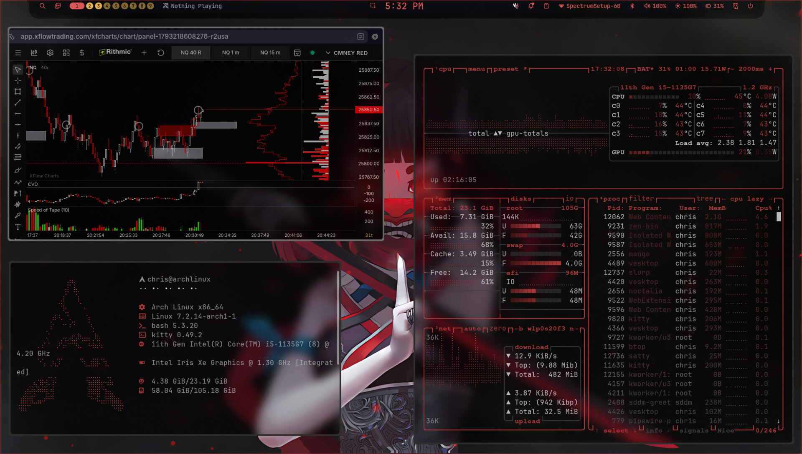

# arch-dotfiles

My Arch Linux setup on a ThinkPad T14 Gen 2. MangoWC + Noctalia v5,
red on black. Companion to my Void setup at
github.com/ChrissDevv/Dotfiles — same look, different distro.

## Screenshot

## The machine

- ThinkPad T14 Gen 2, i5-1135G7, 24 GB RAM
- Dual boots Windows and Arch; Windows is kept for trading charts
- Timeshift takes a snapshot before every pacman upgrade

## The stack

| Piece | What it does |
| --- | --- |
| MangoWC | Wayland compositor, dwl/wlroots based. Config is `~/.config/mango/config.conf`, reloads with Super+Shift+C. |
| Noctalia v5 | Bar, launcher, control center, notifications. Started by `exec_once=noctalia`. |
| kitty | Terminal. |
| bash + starship | Shell and prompt. |
| fastfetch | System info, red `#c04040` truecolor. |
| btop | System monitor, custom `cmney-red` theme. |
| rofi | Secondary launcher, on Alt+Space if re-enabled. |
| Zen browser | `zen-browser-bin` from the AUR. |
| Vesktop | Discord, with refact0r's system24 theme recoloured red. |
| Liner | Music, AppImage in `~/Applications`. |

## Installing on a new machine

1. Official packages: `sudo pacman -S --needed - < packages-pacman.txt`
2. AUR packages: `yay -S --needed $(cat packages-aur.txt)`
3. Copy `config/*` into `~/.config/`, except `config/vesktop/themes`,
   which goes to `~/.config/vesktop/themes`
4. Copy `local-bin/*` into `~/.local/bin/` and `chmod +x` them
5. Add yourself to the `video` group (see below)

## Things that cost me time

**Brightness keys did nothing.** The user must be in the `video` group
for anything to write to `/sys/class/backlight`. `brightnessctl`'s
package ships the udev rule that grants it:
`sudo usermod -aG video $USER`, then log out and back in. The binds now
call `brightnessctl` directly rather than going through Noctalia, whose
brightness-down did nothing.

**Noctalia never came back after a reboot.** Mango autostarts with
`exec_once=` lines in config.conf, not an `autostart.sh` and not
`exec=`. Without it there's no bar and no notifications.

**Region screenshots blanked the screen.** slurp's default dim layer
covers everything under Mango. Passing `-b 00000000` makes it
transparent, so you can see what you're selecting.

**Window transparency** is per-app via `window_rule=`, matched on
app_id. Zen's app_id is `zen`, Vesktop's is `vesktop`; find others with
`grep StartupWMClass /usr/share/applications/<app>.desktop`. Rules only
apply when a window is created, so restart the app after a reload.

## Keybinds

Super is the mod key. Matched to my Void/SwayFX setup so both machines
feel the same.

| Keys | Does |
| --- | --- |
| Super+Shift+Return | kitty |
| Super+P | Launcher |
| Super+C | Control center |
| Super+comma | Noctalia settings |
| Super+B | Zen browser |
| Super+S / Super+Shift+S | Screenshot full / region |
| Super+Q | Close window |
| Super+F | Fullscreen |
| Super+Space | Float toggle |
| Super+N | Switch layout |
| Super+H/J/K/L | Focus |
| Super+Shift+H/J/K/L | Move window |
| Super+Tab | Focus next window |
| Super+1..9 | Go to workspace |
| Super+Shift+1..9 | Send window to workspace |
| Alt+Shift+Left/Right | Focus other monitor |
| Super+Alt+Left/Right | Send window to other monitor |
| Super+Shift+C | Reload config |
| Super+Shift+E | Quit Mango |

Mouse: Super+drag left to move, Super+drag right to resize.

## Theme

Red `#c04040` on black everywhere. Global window opacity 0.9 focused /
0.85 unfocused, with Zen and Vesktop pushed further down. btop's theme
leaves `main_bg` empty so the terminal background shows through.

## Not in here, on purpose

`~/.config/vesktop` beyond the themes folder, because it holds the
Discord session token. SSH keys. Anything under `/etc`.
